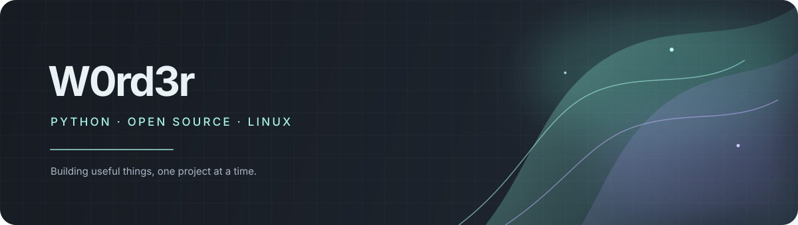

<!--
  W0rd3r · GitHub profile
  Replace YOUR_BUYMEACOFFEE_USERNAME once your support page is ready.
-->

  
   

  <h1>Hey, I'm W0rd3r 👋</h1>
  
<strong>Python developer · Open-source enthusiast · Linux user</strong>

  

    Building useful tools, exploring new ideas, and learning by making.
     
    Mostly Python, with a soft spot for clean interfaces and open source.
  

  

    
    
  

---

### About

- 🐍 **Main language:** Python
- 🐧 **Daily environment:** Linux · CachyOS
- 🛠️ **I enjoy:** developer tools, automation, desktop apps, and bots
- 🌱 **Currently:** improving my Python skills and building open-source projects
- 🎨 **Design taste:** minimal interfaces, graphite tones, and a little Miku-inspired color

### Selected projects

| Project | What it is |
| --- | --- |
| [LibreGram Desktop](https://github.com/W0rd3r566/libregram-desktop) | An experimental Telegram desktop client |
| [Forge System Center](https://github.com/W0rd3r566/Forge-System-Center) | A personal system tools project |
| [W0rd3r Skillbook](https://github.com/W0rd3r566/w0rd3r-skillbook) | A collection of practical skills for AI coding agents |
| [mdnest](https://github.com/W0rd3r566/mdnest) | A Markdown-focused editor project |

### Tools I use

  
  
  
  

### A little more

I like building things that solve real problems, polishing the details, and sharing what I learn.
This profile is a small map of what I'm working on. More experiments are on the way.

---

  Made with Python, curiosity, and a hint of teal.
   
  © W0rd3r

